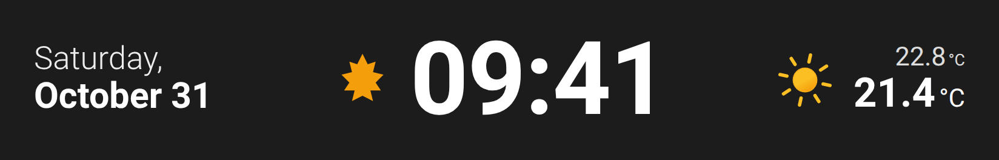
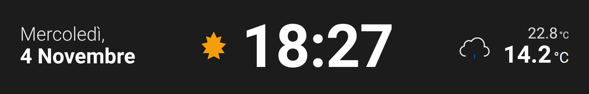
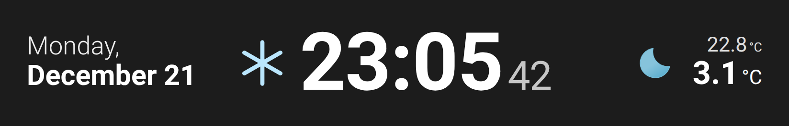
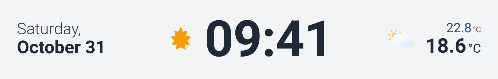
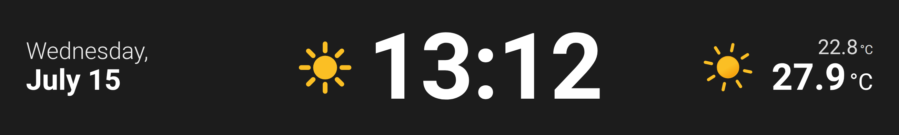
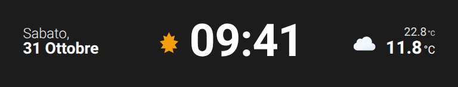
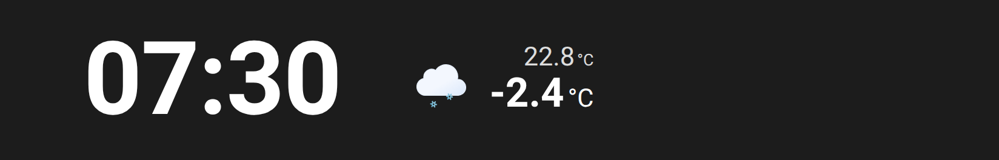
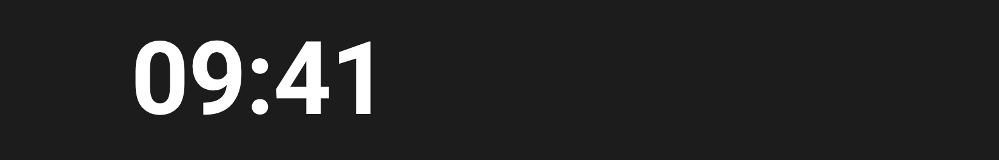
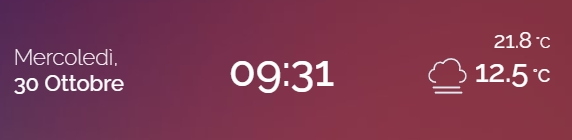
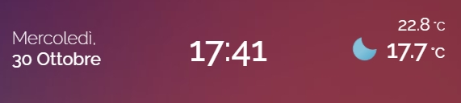

# Clock Strip Card - data, ora e meteo per Home Assistant

[](https://hacs.xyz) [](https://github.com/Simonz82/date_hours_meteo/actions/workflows/validate.yml)

[](https://my.home-assistant.io/redirect/hacs_repository/?owner=Simonz82&repository=date_hours_meteo&category=plugin)

Una striscia unica per le dashboard di Home Assistant: **data | stagione + ora | meteo + temperature interna ed esterna**, sempre su una sola riga e proporzionale alla larghezza, perfetta per un tablet a muro, un telefono o la testata di una vista.

*A single-row strip for Home Assistant dashboards: date | season + time | weather + indoor/outdoor temperature. English summary at the bottom.*



## Screenshot

| | |
|---|---|
|  |  |
| Lingua italiana, pioggia | Notte, secondi attivi, icona luna |
|  |  |
| Tema chiaro, sfondo della card (`transparent: false`) | Pannello largo, estate |
|  |  |
| Telefono (360 px): stessa riga, tutto in scala | Solo ora e meteo (`show_date: false`, `show_season: false`) |

Solo ora (nessun meteo, data o stagione):



## Caratteristiche

- **Una riga sola**: data a sinistra, stagione + ora al centro, meteo e temperature a destra.
- **Scala con la larghezza** (unita' CSS container query `cqw`): niente layout stretto, niente andate a capo.
- **Editor visuale** (etichette italiane o inglesi in base alla lingua di Home Assistant).
- **Ora e data dal browser** con il fuso orario e la lingua di Home Assistant; secondi opzionali.
- **Stagione automatica** dalla data (emisfero sud compreso) oppure da un sensore tuo.
- **Icona meteo giorno/notte** (usa `sun.sun`); se il set di SVG non e' installato usa le icone `mdi:` di Home Assistant.
- **Sfondo trasparente** di default, oppure lo sfondo standard delle card.
- Nessuna dipendenza da altre card.

## Installazione

### Con HACS (consigliata)

1. Clicca il pulsante qui sotto per aprire il repository in HACS (se non funziona, procedi a mano con i punti seguenti):

   [](https://my.home-assistant.io/redirect/hacs_repository/?owner=Simonz82&repository=date_hours_meteo&category=plugin)

   A mano: HACS > menu a tre puntini > **Repository personalizzati**.
2. Repository: `https://github.com/Simonz82/date_hours_meteo`, tipo **Dashboard** (Lovelace). Aggiungi.
3. Cerca "Clock Strip Card", scarica, ricarica il browser (svuota la cache se serve).

HACS aggiunge da solo la risorsa Lovelace.

### Manuale

1. Copia `shc-clock-strip-card.js` in `/config/www/`.
2. **Impostazioni > Dashboard > menu a tre puntini > Risorse > Aggiungi risorsa**: URL `/local/shc-clock-strip-card.js`, tipo **Modulo JavaScript**.
3. Ricarica il browser.

### Icone meteo (facoltative ma consigliate)

La card cerca gli SVG in `/local/weather_icons/<stato>.svg` (`sunny`, `clear-night`, `cloudy`, `partlycloudy`, `rainy`, `snowy`...). Copia nella tua cartella `/config/www/weather_icons/` i file di [`www/ic/weather_icons/animated/`](www/ic/weather_icons/animated) di questo repository. Senza, la card usa le icone `mdi:` di Home Assistant.

### Icone stagione (facoltative)

Di serie sono usate icone SVG integrate. Se vuoi le tue, metti in una cartella 4 immagini `01.png` (primavera), `02.png` (estate), `03.png` (autunno), `04.png` (inverno) e indica il percorso in `season_images`.

## Configurazione

Aggiungi la card dall'editor visuale (cerca "Clock Strip") oppure in YAML:

```yaml
type: custom:shc-clock-strip-card
weather_entity: weather.home
outdoor_entity: weather.home
indoor_entity: sensor.living_room_temperature
```

### Opzioni

| Opzione | Tipo | Default | Descrizione |
|---|---|---|---|
| `type` | string | **obbligatorio** | `custom:shc-clock-strip-card` |
| `indoor_entity` | entita' | - | Sensore di temperatura interna (cifra piccola, sopra). |
| `outdoor_entity` | entita' | - | Temperatura esterna (cifra grande, sotto): un `sensor.*` oppure un `weather.*` (legge l'attributo `temperature`). |
| `weather_entity` | entita' | - | Entita' `weather.*` che decide l'icona meteo. |
| `season_entity` | entita' | - | Sensore con la stagione (`spring`, `summer`, `autumn`, `winter` oppure `primavera`, `estate`, `autunno`, `inverno`). Vuoto = calcolata dalla data e dalla latitudine di Home Assistant. |
| `show_date` | bool | `true` | Mostra giorno della settimana e data a sinistra. |
| `show_seconds` | bool | `false` | Mostra i secondi accanto all'ora. |
| `show_season` | bool | `true` | Mostra l'icona della stagione accanto all'ora. |
| `show_weather` | bool | `true` | Mostra icona meteo e temperature a destra. |
| `transparent` | bool | `true` | `true` toglie sfondo e bordo; `false` usa lo sfondo del tema. |
| `season_images` | string | `/local/stagioni/var1/` | Cartella (URL) delle immagini stagione `01.png`-`04.png`. Se mancano, icone SVG integrate. |
| `weather_icons` | string | `/local/weather_icons/` | Cartella (URL) degli SVG meteo. Se mancano, icone `mdi:`. |

Per le viste a sezioni si puo' usare anche `grid_options` (es. `columns: full`). Altri esempi pronti in [docs/examples.yaml](docs/examples.yaml).

### Esempi

Solo orologio e data:

```yaml
type: custom:shc-clock-strip-card
show_weather: false
show_season: false
```

Temperatura esterna da un sensore reale, con i secondi:

```yaml
type: custom:shc-clock-strip-card
weather_entity: weather.home
outdoor_entity: sensor.outdoor_temperature
indoor_entity: sensor.living_room_temperature
show_seconds: true
```

Sfondo standard e immagini tue:

```yaml
type: custom:shc-clock-strip-card
weather_entity: weather.home
outdoor_entity: weather.home
transparent: false
season_images: /local/my_seasons/
```

## FAQ e problemi comuni

**La card non compare / "Custom element doesn't exist".** La risorsa non e' caricata: controlla in Impostazioni > Dashboard > Risorse che esista `/hacsfiles/date_hours_meteo/shc-clock-strip-card.js` (HACS) o `/local/shc-clock-strip-card.js` (manuale), tipo Modulo JavaScript, poi ricarica con cache svuotata.

**Le icone meteo non si vedono o sono diverse.** Gli SVG non sono in `/config/www/weather_icons/`: la card passa alle icone `mdi:` di Home Assistant. Copia gli SVG del repository oppure cambia `weather_icons`.

**Manca la temperatura esterna.** Con un'entita' `weather.*` viene letto l'attributo `temperature`; con un sensore serve uno stato numerico. Se l'entita' e' `unavailable` la cifra resta vuota.

**La data e' in inglese.** La data usa la lingua del profilo utente di Home Assistant (Profilo > Lingua).

**L'ora e' sbagliata di qualche ora.** Usa il fuso orario impostato in Home Assistant (Impostazioni > Sistema > Generale). Controlla quello.

**La stagione e' sbagliata.** Se usi `season_entity`, lo stato deve essere uno dei valori elencati sopra; altrimenti toglila e la card calcola da sola.

**Dopo un aggiornamento vedo ancora la vecchia versione.** Con una installazione manuale aggiungi un parametro alla risorsa (`/local/shc-clock-strip-card.js?v=1.0.0`) e svuota la cache del browser o dell'app Companion.

**Dove sono le impostazioni della vecchia versione?** Vedi sotto.

## Versione classica (button-card + layout-card)

La prima versione, fatta con `button-card` e `layout-card`, e' ancora nel repository e funziona come prima: `date_hours_meteo_card.yaml`, `packages/sensor_time_e_date.yaml` e le icone in `www/ic/weather_icons/animated/`. Istruzioni:

1. Da HACS installa **button-card** e **layout-card**.
2. Incolla `packages/sensor_time_e_date.yaml` nella cartella `packages`.
3. Copia le icone meteo in `www/weather_icons/`.
4. Crea una card manuale con il contenuto di `date_hours_meteo_card.yaml`.
5. Sostituisci i sensori di temperatura interna (riga 66) ed esterna (righe 69 e 75) con i tuoi.
6. Regola dimensioni e allineamenti nelle sezioni CARD, NAME, LABEL dei 3 blocchi: data, ora e meteo.





## Changelog

Vedi [CHANGELOG.md](CHANGELOG.md). Ultima versione: **1.0.0**.

## English summary

**Clock Strip Card** is a Lovelace card for Home Assistant showing, on a single responsive row, the date, the season icon, the time, a weather icon and the indoor and outdoor temperatures. It scales with the card width (CSS container queries), has a visual editor, uses the Home Assistant language and time zone, and needs no other card.

- **Install with HACS**: click the My Home Assistant button at the top of this page, or manually: three-dot menu > Custom repositories > `https://github.com/Simonz82/date_hours_meteo` > type *Dashboard*, then download "Clock Strip Card". **Manual**: copy `shc-clock-strip-card.js` to `/config/www/` and add `/local/shc-clock-strip-card.js` as a JavaScript module resource.
- **Weather icons**: copy the SVGs from `www/ic/weather_icons/animated/` to `/config/www/weather_icons/` (otherwise built-in `mdi:` icons are used).
- **Options** are listed in the table above (same names and defaults): `indoor_entity`, `outdoor_entity`, `weather_entity`, `season_entity`, `show_date`, `show_seconds`, `show_season`, `show_weather`, `transparent`, `season_images`, `weather_icons`.
- The original **button-card + layout-card** version is kept in this repository (see "Versione classica").
- Issues: use the templates; questions: Discussions.

---

## ☕ Vuoi darmi una mano?

Il contenuto di questa pagina è completamente gratuito e lo scopo non è certamente fare soldi. Se vuoi darmi una mano per le spese e il tempo perso, ecco alcuni modi:

| | |
|---|---|
| [](https://ko-fi.com/C0C713VTGJ) | Offrimi un caffè su Ko-fi |
| [](https://www.paypal.com/paypalme/simongmail) | Una donazione libera su PayPal |
| [](https://amzn.to/3XWWTgz) | Fai i tuoi acquisti Amazon partendo da questo link |

**Canali Telegram:**

| | |
|---|---|
| [](https://t.me/Home_Assistant_News) | Notizie dedicate a Home Assistant |
| [](https://t.me/offerte_domotica_ita) | Offerte sui prodotti di domotica |

---

Sviluppato e curato da [Simonz82](https://t.me/Simonz82) · © 2026
